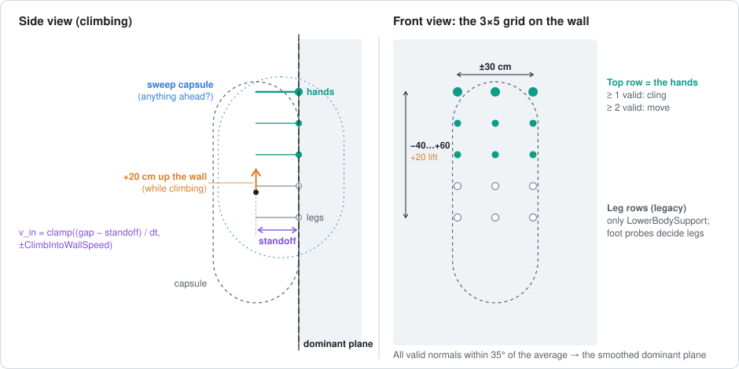

# Climbing — Enter detection & wall contact

Climbing needs one cheap, stable answer about the wall: *is there a climbable wall here, and which plane is it?* Every tick, a forward sweep checks whether anything is ahead, and a **3×5 grid** of short line traces checks whether it's a wall. The grid answers three questions: grab on, move along, drop off. It also produces one smoothed **dominant plane** that the climb mode moves against. A sample counts as wall when

```
|n·Up| ≤ sin(MaxWallTiltFromVerticalDegrees)   and   n·Up < MantleMinWalkableDot
```

While climbing, the capsule is held on that plane by a regulated pull, not a constant press:

```
v_in = clamp((gap − standoff) / dt, ±ClimbIntoWallSpeed)
```

The grid keeps running the whole time you climb, not only at entry. The detailed wall shape for the pose is the [surface map](surface-warp.md#map-vs-the-35-coverage-grid). Part of the [Climbing docs](README.md).



## Per tick (pre-sim)
```
SweepAndStoreWallHits → RefreshClimbSurfaceInfo (grid → gates → dominant plane) → surface map, pins, probes…
```

## 1. Sweep: anything ahead?
- `SweepAndStoreWallHits` sweeps a capsule (`ClimbDetectionCapsuleRadius` 50, `HalfHeight` 72) `ClimbDetectionForwardOffset` (20 cm) ahead, into `CurrentWallHits`.
- It's detection only: a multi-sweep returns one hit per component, not coverage.
- Nothing hit → the grid is **skipped** entirely (no traces).

## 2. The 3×5 grid
- `ClimbGridColumns` × `ClimbGridRows` (3 × 5) line traces along the capsule's **forward**, `ClimbSampleReach` (70 cm) long.
- Rows run from `ClimbGridBottomOffset` (−40) to `ClimbGridTopOffset` (+60) around the capsule centre; columns span ±`ClimbGridHalfWidth` (30).
- **While climbing, the grid follows the wall:**
  - rows stack along `WallUp`, columns along `WallRight`, both from last tick's plane;
  - the whole grid (and the sweep) is lifted `OnClimbAdditionalOffset` (20 cm) **up the wall** (`GetClimbSampleUpBias`), because hands reach high and legs curl;
  - on a tilted wall, a world-up grid would walk its top rows off the face.
- **At entry**, the grid uses world up and right (the character is upright, and there's no plane yet).
- **Valid sample:** a `ECC_WorldStatic` hit that passes the wall rule (below), and faces the character within `MinHorizontalDegreesToStartClimbing` (25°).
  - The facing test is horizontal: the forward is flattened, so a tilted capsule's forward doesn't tighten it on steep walls.
- **Top row = the hands.** The bottom `ClimbLowerBodyRowCount` (2) rows only feed the legacy `LowerBodySupport` value. The leg hang is decided by the per-foot probes ([Limb IK](limb-ik.md#foot-probes-hang-detection)).

## 3. Wall vs walk (`IsSurfaceClimbable`)
- **Wall** = leans ≤ `MaxWallTiltFromVerticalDegrees` (40°) from vertical **and** isn't a walkable top (`n·Up < MantleMinWalkableDot`, 0.7 ≈ 44°).
- Keep the two **ordered**, wall lean (sin 40° ≈ 0.64) below the walkable slope (0.7). That ordering *is* the gate; otherwise flat tops would count as walls.
- Shared by every climb action: the grid, the foot probes, the surface map, mantle up and down.

## 4. Gates
| Gate | Rule | Effect |
|---|---|---|
| Hand purchase | Top row has ≥ `ClimbTopRowMinHits` (1) valid cells | `CanClimbNow()`: grab on, stay on |
| Consistency | Every valid normal within `MaxClimbNormalDeviationDegrees` (35°) of the average | Rejects corners and broken geometry |
| Move | Top row has ≥ `ClimbTopRowMinHitsToMove` (2) valid cells | `CanMoveWhileClimbing()`: shuffle along |

- Hand purchase is the **only** coverage requirement: the hands hold you on, while the torso and legs may miss.
  - The old whole-grip coverage ratio (`MinClimbCoverageRatio`) was removed: it passed a missing top row and failed a good one-hold ledge.
- **One handhold = cling:** the climb mode zeros the along-wall input, and `GetClimbMoveSpeedFraction()` returns 0. The anim holds, and the hang blend collapses to the relaxed dead-hang idle.

## 5. Dominant plane
- The average of the valid samples' normals and points, **smoothed** with `VInterpTo` at `ClimbNormalSmoothingSpeed` (10) to damp jitter on curved walls.
  - It snaps (no smoothing) on the first tick after the wall is re-acquired.
- It's the only wall data in the sim; everything else stays component-side for anim.
- **Read by:**
  - the climb mode (move basis, standoff);
  - capsule alignment (`bAlignToClimbSurface`: up follows `WallUp`, forward into the wall);
  - the [surface map](surface-warp.md), the limb IK wall planes, and the mantle and corner probes.
- `ClimbSurfaceSamplesCache` keeps the per-sample results for anim and debug.

## 6. Enter & exit (`URogueClimbTransition`)
- **Enter (contextual):**
  - `CanClimbNow()`;
  - pushing into the wall (`dot(intent, −n) ≥ ClimbEnterIntoWallDot`, 0.5);
  - airborne, if `bRequireAirborneToGrab`;
  - not in another climb-family mode (mantle, corner turn);
  - not within `ClimbReentryCooldownSeconds` (0.3 s) of the last climb.
- **Exit → Falling:** a jump, or `CanClimbNow()` false (the hands lost the wall). At a lip, the mantle catches it first ([Mantle](mantle.md)).

## 7. Wall contact: standoff, not a press
- Each tick the climb mode measures the perpendicular gap from the capsule centre to the dominant **plane** and moves toward `ClimbWallStandoff` (0 = auto = capsule radius, just touching), clamped to `ClimbIntoWallSpeed` (40 cm/s).
  - It eases to a stop on arrival and nudges back **out** if the capsule sank past the standoff.
  - Not scaled by the climb's surge: contact shouldn't pulse with the anim.
- **Why (the hang bug):** a constant press had nothing to brace against in a hang (the body over a void, only the hands on the wall):
  - it crept the capsule **into** the surface, so the grid's ray origins started inside the wall, the rows read empty, and the climber gradually fell;
  - it also slid the body down;
  - `ClimbIntoWallSpeed = 0` stopped the fall but left a gap: the press had been doing two jobs.
- Measuring to the **infinite plane** keeps the standoff valid even when the wall only exists up at the hands. (The trace-origin back-off idea was dropped: this removes the cause.)

## Settings
| Setting | Default | Meaning |
|---|---|---|
| `ClimbDetectionCapsuleRadius` / `HalfHeight` | 50 / 72 cm | The sweep capsule |
| `ClimbDetectionForwardOffset` | 20 cm | How far ahead it sweeps |
| `OnClimbAdditionalOffset` | 20 cm | Lift of the sweep and grid up the wall while climbing |
| `ClimbGridColumns` × `Rows` | 3 × 5 | Grid traces |
| `ClimbGridHalfWidth`, `BottomOffset`, `TopOffset` | 30, −40, +60 cm | Grid extent around the capsule centre |
| `ClimbSampleReach` | 70 cm | Trace length |
| `MinHorizontalDegreesToStartClimbing` | 25° | Facing tolerance per sample |
| `MaxWallTiltFromVerticalDegrees` | 40° | Wall lean limit (keep below the walkable slope) |
| `ClimbTopRowMinHits` / `ToMove` | 1 / 2 | Cling / move gates |
| `MaxClimbNormalDeviationDegrees` | 35° | Consistency gate |
| `ClimbLowerBodyRowCount` | 2 | Leg rows (legacy scalar only) |
| `ClimbNormalSmoothingSpeed` | 10 /s | Dominant plane smoothing; 0 = snap |
| `ClimbEnterIntoWallDot` | 0.5 | Push into the wall needed to grab |
| `bRequireAirborneToGrab` | on | Grab only from the air |
| `ClimbReentryCooldownSeconds` | 0.3 s | No re-grab right after leaving |
| `ClimbWallStandoff` (mode) | 0 = auto | Target gap to the plane |
| `ClimbIntoWallSpeed` (mode) | 40 cm/s | Standoff correction speed |

## Debug (`game.climbing.DebugDraw`)
- **Sweep capsule:** green = hit, white = nothing ahead; hits = blue points with cyan normals.
- **Grid traces:**
  - green = valid;
  - orange = hit, but not a wall or not facing;
  - red = miss.
- **Plane arrow:** green = climbable, red = failed a gate.
