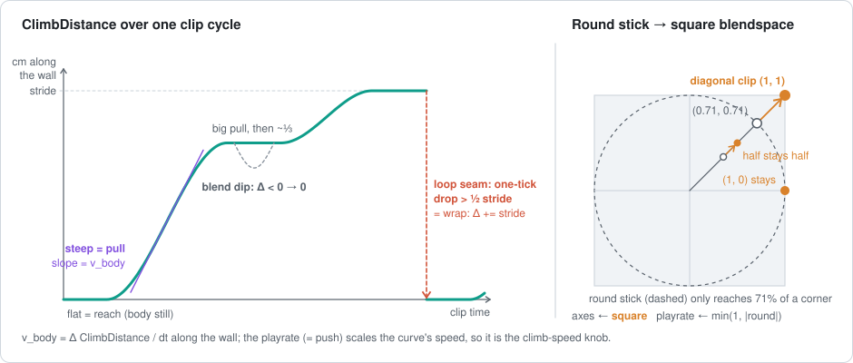

# Climbing — Climb locomotion

The climb clips are **in place** and move in bursts: *reach (body nearly still) → pull (body surges) → reach…*. If the capsule moves at a smooth speed against that rhythm, gripped hands and feet slide on the wall. So **the clip drives the body's speed**. Each clip carries a `ClimbDistance` curve (cumulative travel along the wall), and the body moves by its change:

```
v_body = Δ ClimbDistance / dt       (along-wall magnitude; the direction stays the solver's)
playrate = GetClimbMoveSpeedFraction() · scale
```

A planted contact slides back through the in-place clip exactly as far as the body advances, so they cancel at every instant, not just on average. The stick's round input is also remapped onto the square blendspace, so diagonal clips play fully. Part of the [Climbing docs](README.md).



## Pipeline
```
stick → round intent ─┬─ CircleToSquare ──→ blendspace AXES      (which clip)
                      ├─ min(1, |round|) ─→ blendspace PLAYRATE  (how fast)
                      └─ normalized ──────→ physics DIRECTION    (where)
clip's ClimbDistance → Δ / dt → v_body → climb mode: velocity = direction · min(v_body, ClimbMaxSpeed)
```

## The distance curve
- **Authoring:** a monotonic float curve per clip: 0 at frame 0, rising to the stride at the end. Flat = hold / reach, steep = pull.
- **Bake:** `URogueClimbDistanceBaker` (editor Animation Modifier) builds it from the root-motion sibling's root path, then you hand-tune keys.
  - `AxisWeights` drops an axis before measuring (e.g. Z, so a vertical bob doesn't add distance).
  - `DistanceScale` trims for no-skate without re-baking.
- **Every clip needs it:** curves blend, so diagonals stay right. A curveless direction dilutes the blend, and a curveless clip moves at plain solver speed (push × `ClimbMaxSpeed`), which is a visible tell.
- **What riding the clip buys:**
  - **phase-locked:** the body's pull lands on the clip's pull, with no separate sim phase to drift;
  - **auto-shaped:** the clip's two uneven pulls (big, then ~⅓) are already in the curve;
  - **playrate-proof:** the curve advances by playrate · dt, so **playrate is the climb-speed knob** (`scale` = a free multiplier, e.g. 1.5 = 50% faster).

## Reading a blended curve (`RefreshClimbDistanceSpeed`)
```
Δd = d_now − d_prev
if Δd < −½ stride:  Δd += stride      // a real loop-seam wrap (one-tick drop)
Δd = max(0, Δd)                        // a gradual dip from blending = no advance
```
- **Wrap needs a real jump.** Crossfades and diagonal phase offsets make the blended curve dip gradually. The old "any negative = wrap" rule added a full stride every tick of the move → idle blend-out, and the body lunged forward after release.
- **Input gate:** at push ≤ `FootPlantIdleInputDeadzone` (0.05), the curve stops driving and the solver's `ClimbDeceleration` brakes the body. Otherwise the clip, still genuinely advancing while it blends out, would glide the body on with no input.
  - Exception: during a **bad-segment skip**, `ResolveClimbMoveInput` keeps feeding the last input after release, so the curve keeps driving the body until the skip ends ([Stopping well](idle-retreat.md), layer 1).
- `d_prev` is tracked every tick, even when gated, so resuming from idle doesn't spike.

## Speed caps and the deadlock
- **`ClimbMaxSpeed` (150) is only a safety cap** on a spiking blended curve (a fast direction change, an authoring error).
  - It caps the *instantaneous* speed (the pull peak), so keep it above `peak ClimbDistance slope × max playrate`, or real pulls get clipped and planted limbs skate.
- **Deadlock:** playrate must come from the *steady* push (`GetClimbMoveSpeedFraction()`), never from the body speed. Otherwise a flat hold gives speed 0 → playrate 0 → the clip freezes at the reach.

## Round stick → square blendspace
- The intent is a **round** unit direction (full diagonal = `(0.707, 0.707)`), but the blendspace is a **square** with diagonal clips at `(±1, ±1)`. Without a remap, the diagonals cap at 70.7% and never fully play.
- `CircleToSquare` pushes the intent out to the square along the same ray, keeping the push amount:

```
dir = in / |in|
out = dir / max(|dir.x|, |dir.y|) · |in|     // (0.707, 0.707) → (1, 1);  (1, 0) → (1, 0);  half stays half
```

- **Keep the three consumers apart.** `|GetClimbMoveIntent()|` is √2 on a diagonal; used as the playrate it would play 1.41× too fast, and since the body follows the clip, it would also *move* 1.41× too fast.

| Consumer | Reads | Shape |
|---|---|---|
| Blendspace axes | `GetClimbMoveIntent()` | Square |
| Blendspace playrate | `GetClimbMoveSpeedFraction()` = `min(1, \|round\|)`, 0 when locked to one handhold | Round scalar |
| Physics direction | The climb mode's `WallMoveDir`, normalized | Round |

- Blendspace input order is `(Intent.Y, Intent.X)`: the axes are swapped relative to the intent.

## Why scalar, not full root motion
- The clip drives the along-wall **magnitude** only; the mode keeps the **direction** (on the wall plane) and player control. In effect, it's scalar root motion.
- Full root-motion climbing would fight Mover (fixed tick, rollback, a looping blendspace) and arbitrary geometry, for a rhythm the curve already gives.
- Determinism is a networking concern; moot for single-player / Standalone.
- Root motion + motion warping is kept for **discrete traversals** on known geometry ([Mantle](mantle.md), [Corner turns](corner-turns.md)).

## Code
| Where | What |
|---|---|
| `RefreshClimbDistanceSpeed()` (pre-sim) | Reads `ClimbDistanceCurveName` off the anim instance; wrap rule + input gate → `GetClimbAlongWallSpeed()` |
| `URogueClimbMode::GenerateMove` | `velocity = solverDir · min(v_body, ClimbMaxSpeed)` along the wall. Invalid (idle, or no curve) → the solver's own velocity (brakes with no input). The standoff correction is added on top, unscaled |
| `GetClimbMoveIntent()` | Round intent (`ComputeRoundClimbWallIntent`) → `CircleToSquare` → blendspace axes |
| `GetClimbMoveSpeedFraction()` | `min(1, \|round intent\|)` → blendspace playrate; 0 when locked |
| `URogueClimbDistanceBaker` (editor) | Bakes `ClimbDistance` from the root-motion sibling |
| AnimBP / assets | Playrate wiring, per-clip curves |

## Settings
| Setting | Default | Meaning |
|---|---|---|
| `ClimbDistanceCurveName` | `ClimbDistance` | The curve read off the anim instance |
| `ClimbMaxSpeed` (mode) | 150 cm/s | Safety cap on the curve speed; also the solver's speed for a curveless clip |
| `ClimbAcceleration` / `ClimbDeceleration` (mode) | 512 / 1024 | Solver ramps (the deceleration brakes at idle) |
| `FootPlantIdleInputDeadzone` | 0.05 | Push below this = idle (shared with the limb IK) |

*History:* this replaced (2026-10-31) a speed-led model. The body moved at `fraction · ClimbMaxSpeed` with the playrate synced to it, plus a per-clip cadence surge curve. Three numbers had to stay consistent; the distance curve makes the clip the only source of truth.
