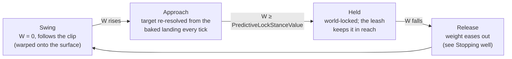
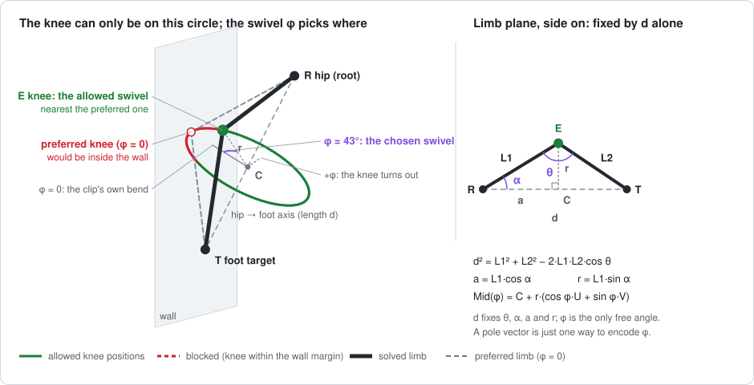
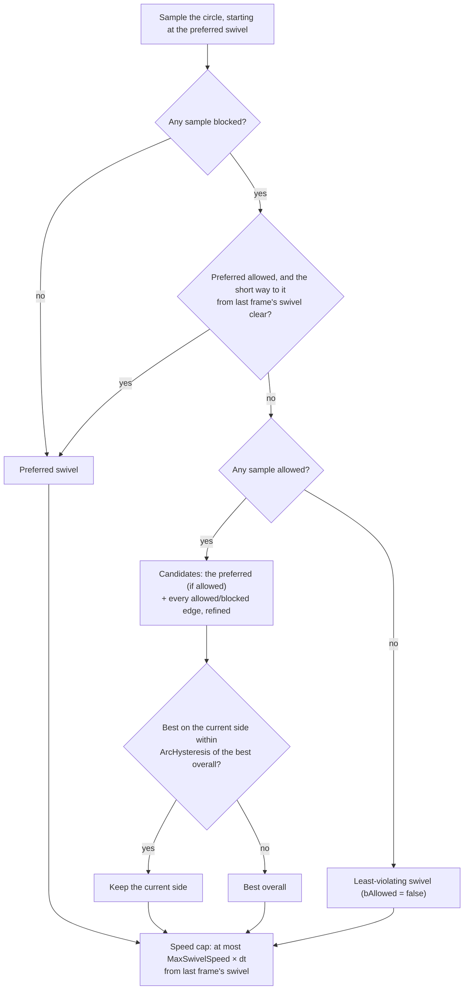

# Climbing — Limb IK

Each hand and foot is placed by two pieces. The **component** decides *where* (a world-locked **pin** per limb, predicted from the clip's baked contacts) and *how much* (the clip's **stance curve**). The **Climb Limb IK** Control Rig node decides *how the limb bends*. Once the distance to the target is fixed, the knee / elbow can only sit on a circle around the root → target axis:

```
C = Root + Axis·L1·cos α,   r = L1·sin α,   mid = C + r·(cos φ·Bend + sin φ·(Axis × Bend))
```

The node picks the **swivel φ** on that circle: the clip's own bend when it's allowed, otherwise the nearest swivel that keeps the joint out of the wall and the body. It never flips sides abruptly. Data flows one way, component → AnimBP → rig. Stopping and direction changes are in [Stopping well](idle-retreat.md); curved walls are in [Surface map & warp](surface-warp.md). Part of the [Climbing docs](README.md).

## Pipeline
```
component (pre-sim):  stance curve + baked landing → pin (where) + weight (how much) → IK follow → LocalLocation, Weight
rig (anim):           input pose → weight shift → Climb Surface Warp → Climb Limb IK (pin, Weight, Planes) → pose
```

| | Component (game thread, pre-sim) | Rig node (anim evaluation) |
|---|---|---|
| Question | *Where* may the target be? | *How* does the limb bend? |
| Pose | Last frame's | Current, after the weight shift and the warp |
| Needs | Only "is **any** swivel allowed?" (`HasAllowedSwivel`) | Preferred swivel, last frame's swivel, the best allowed |
| Acts on | Pin placement, the leash, re-grips | Bone rotations |

- **Solve twice, one-way data.** The component checks with stricter margins, so a target it accepts won't fail in the rig a frame later.
- The rig's `bAllowed` / `Strain` are debug only. Sending them back would cross threads, arrive a frame old, and drive policy from the IK'd result, which is the feedback loop the drift-free rules forbid.
- **Why not solve in the component and just apply joint transforms:** the component ticks before this frame's animation exists. The lag would move from the decision (absorbed by margins) into the pose (a planted hand swimming ~1–3 cm a frame), and C++ has no FK pose for the preferred swivel.

## Part 1 — Pins: where and how much

### What the rig reads (`FClimbLimbPin`)
- One pin per limb (`LeftFootPin`, `RightFootPin`, `LeftHandPin`, `RightHandPin`), refreshed every pre-sim tick by `RefreshLimbPins`.
- `Weight` (0..1, > 0 = pinned): the effector alpha.
- `LocalLocation` / `LocalNormal`: the target in **mesh-component space**. Feed these; a world position flings the rig.
- `Location` / `Normal`: the raw world pin (debug, and the break test).
- `Reach`: the limb's leash limit and contact point, for the [Climb Surface Warp](surface-warp.md#reach-rule) node.
- An unpinned pin freezes its last `Location`, so a blend-out never aims at the world origin.

### Stance curves and the contact point
- One authored float curve per limb (`Stance_FootL/R`, `Stance_HandL/R`): holding (IK on) vs swinging (follows the clip). It's also the IK blend profile.
  - A limb with no curve stays dormant, so limbs can be enabled one at a time.
- **Contact point = probe point = IK point.** Aim the baked contact bone, the socket knobs and the rig's effector tip at the real contact (a palm socket, `ball_l`), not the wrist / ankle.
  - Then `LimbPinSurfaceOffset` (the lip standoff along the normal) reads the same on every limb.
  - It's applied **once at consume** (into `LocalLocation`, from the raw pin), so it can't accumulate.

### Predictive placement (sustained climb)
- **Bake, offline:** `URogueClimbContactBaker` (an Animation Modifier) finds each plant at the stance curve's rising crossing of `PlantDetectThreshold`.
  - It stores the contact's **component-space** landing in `URogueClimbContactMetaData`: two per limb on two-strike clips, with holds that wrap the loop seam handled circularly.
  - It also stamps a monotonic `ClimbPhase` 0 → 1 curve, because a stance value repeats and a phase value doesn't.
- **Destination clip:**
  - Moving = the dominant blendspace sample (`GetDominantClimbClip`; note the axis swap, BS input = `(Intent.Y, Intent.X)`).
  - Idle = `ClimbIdleClip`, baked the same way.
- **Per limb, per tick:**
  1. Phase from the live `ClimbPhase` curve.
  2. `W` = the **destination clip's own** stance curve at that phase, never the blended pose (crossfades smear it).
  3. Plant = the nearest in phase, circularly (`FindNearestPlant`).
  4. While unlocked: target = `MeshXform · Landing`, warped through the surface map and traced onto the wall (`ResolvePlantTarget`). It's re-resolved every tick, so the body's travel is folded in.
  5. `W ≥ PredictiveLockStanceValue` → world-lock. The [reach leash](idle-retreat.md) then keeps the held pin within the limb's reach.
  6. A trace miss (over a void) aims at the predicted anchor itself.
- **"The transition-to decides":** code state picks the regime (moving / idle / corner); the destination clip's own curve supplies the clean signal; inertialization smooths the pose.



### IK follow
- `LimbIKFollowSpeed` (1/s, default 15, `Mover|Climbing|LimbIK|Follow`) drives **both** the target given to the rig and the weight.
- **Exponential** (`VInterpTo` / `FInterpTo`): each tick closes speed × dt of the gap. That's ~63% after 1/speed and ~95% after 3/speed (0.2 s at 15). 0 = raw.
- **Frames:** a held pin is followed **in world** (it doesn't move). An approaching one is followed **in the body's frame**, so the body's own travel adds no lag.
- A limb **not shown last tick** (weight 0) starts **at** its target.
- Inside a blendspace clip-switch window, both run at that window's rate.
- Keep it high enough that the weight tracks the authored ramps.
- **Why it replaced the target spring:** the spring started stale on an approach's first tick and trailed body-moving targets by ~0.18 s × speed, then slid into the hold after the lock. Both came from easing in the wrong frame and resetting on the wrong tick.

### Corner turns: reactive pins
- The corner clips have no baked contacts, so each limb probes **both faces** from its live bone and pins to the nearest valid hit (`ResolveLimbPin`).
- The corner clip's stance curves gate pin and release (`LimbStanceThreshold`); weight = the stance curve.
- **Acquire at the hit, then hold rigidly; never re-probe a held pin.** Re-probing reads the limb the IK already moved, so the pin creeps.
- The leash drags a held pin along its face; one it can't keep in reach holds (the reach cap bends it) until the stance ends.
- **Over a void:**
  - Arm: edge-search back toward the last grip; else grace-hold the last grip; else play the clip.
  - Leg: stays unpinned, and the foot probe's `bHanging` drives the hang.

### Foot probes (hang detection)
- `ProbeFoot` sphere-sweeps from the **animated foot** toward the dominant plane, within `FootProbeReach`. A climbable same-face hit = a foothold; otherwise `bHanging`.
- **Release hysteresis:** a planted foot searches wider (`FootProbeReleaseHysteresis`), so it's harder to release than to acquire.
- **The flicker was a feedback loop, not noise:** the climb pose puts the foot farther out than the hang pose, so plant → foot out → miss → hang → foot in → hit → plant, round and round.
- **Fix: the idle latch.** While idle, a hanging foot may not re-plant, so hang becomes an absorbing state and converges to a still dangle. Moving re-enables re-planting (motion hides the loop).

### Drift-free rules
1. Never re-probe a held pin.
2. Break off a body point, not the IK'd limb.
3. Apply the surface offset once at consume, from the raw pin.
4. Predictive targets come from the **baked anchor** resolved against the mesh root, never from the live, IK'd limb.

*History:* the sustained climb first used reactive pins with a pile of settle, relax and re-acquire rules. Predictive placement replaced all of it (2026-11-01); the reactive resolver survives only for corner turns.

## Part 2 — Solver: how the limb bends

### Why not Basic IK
- **Flips:** Basic IK's bend is the pole's offset projected off the *IK* line. A pole at the FK elbow is only exact while the target is near the FK end. Far from it the projection flips, and a straight FK limb (the dead hang) has no usable pole.
- **Impossible poses inside reach:** the leash only limits *max* distance. A close target folds the limb flat (the "foot above the pelvis" case), and nothing keeps knees and elbows out of the wall or the torso.

### The model



- `d = |target − root|` fixes the knee / elbow angle θ and the upper-bone angle α (law of cosines), so the mid joint lies on the circle above.
- The only free choice is **φ**. A pole vector is just one way to encode it.
- In `TwoBoneIK.cpp` terms: `Angle` = α, `JointLineDist` = r, `ProjJointDist` = a (= `L1·cos α`), `JointBendDir` = the φ direction.
- In the picture, the clip's own bend (φ = 0) puts the knee inside the wall margin, so the solver takes the nearest allowed swivel, 43° out.

| Limit | Becomes |
|---|---|
| Knee / elbow fold (`MinMidAngle`) and straight (`MaxReachRatio`) | A range for `d`; the target is clamped into it |
| Planes, spheres, capsules the joint must stay out of | Blocked arcs of the circle |
| Preferred angle | The swivel to aim for |
| No flips | Stay on the current side of a blocked region (hysteresis), plus a swivel speed cap |

### Code
- `FRogueLimbSwivelSolver` (`RogueLimbSwivelSolver.h/.cpp`): plain C++, so the rig node and the component run the same math.
- `FRigUnit_RogueClimbLimbIK` (`RigUnit_RogueClimbLimbIK.h/.cpp`): the **Climb Limb IK** node, a drop-in for Basic IK (same items, effector, axes, stretch).
  - Bone lengths always come from the reference pose, so `EffectorItem` is required.

### φ = 0 is the clip's own bend
- The node reads the FK hinge (upper × lower) whenever the FK limb is bent (> ~5°, fully trusted > ~15°).
- It remembers the hinge in the upper bone's space for when the limb is straight (`bLearnHingeAxis`). `HingeAxis` is only the fallback before it has seen a bend.
- The hinge is carried from the FK line onto the IK line by the minimal rotation between them, and bend = axis × hinge.
  - This reproduces the FK knee exactly when the target is the FK end.
  - It can't degenerate, because it comes from the bone's orientation, not the elbow's position.
- `PreferredSwivelOffset` (degrees, right-handed about root → target) aims off it. The sign for "knee out" differs per side.

### Choosing φ (`ChooseSwivel`)
- Sample the circle (`NumSamples`), starting at the preferred swivel.
- If the preferred is allowed and the short way to it from last frame is clear, take it.
- Otherwise the candidates are the preferred (if allowed) plus every allowed / blocked **edge**, refined by bisection.
  - The best on the **current side** wins, unless another is closer to the preferred by more than `ArcHysteresis`.
  - Current side = reachable from last frame's swivel the short way without crossing a blocked region.
- **Speed cap** (`MaxSwivelSpeed`): a forced change of side sweeps instead of flipping.
- Nothing allowed → the least-violating swivel, with `bAllowed = false`.
- *Why per side, not per arc:* with the preferred inside a blocked region, both edges can belong to one wrap-around arc. The speed cap would then move between them the short way, through the blocked region.



### Colliders, weight, outputs
- **Planes** test the mid joint. With the effector on the allowed side, the whole lower bone is then out of the plane.
- **Spheres and capsules** test the mid joint **and** the middle of the lower bone (not its end, which touches the wall by design), padded by `JointRadius`.
- **Body colliders:** capsules on bones (`BodyColliders`: torso, pelvis, head, the other limb), resolved each frame.
- **The wall:** `ClimbLimbIKPlanes` from the component (mesh space, `RefreshLimbIKPlanes`) → the node's `Planes` pin.
  - While climbing: the dominant plane.
  - Inner corner turn: both faces.
  - Outer corner, or off the wall: none (around a convex edge the old face's plane runs through open air).
  - `LimbIKWallMargin` = how far the joint's centre stays off the surface.
- **Weight:** `BlendMode = Target` (default) solves at full strength toward a target blended FK end → effector.
  - Every in-between frame is a real single-chain pose, and weight 0 is exactly FK.
  - At weight 0 the node remembers the FK bend, so the swivel eases back in from it.
  - `Rotation` = the old Basic IK slerp.
- **Outputs:** `Swivel` (degrees from the FK bend), `bAllowed`, `Strain` (cm of clamp shortfall + collider penetration).
- **Debug draw:**
  - the circle: green = allowed, red = blocked;
  - white = the chosen spoke; yellow spoke = the preferred, when moved off it;
  - yellow line = the clamped part of the target; grey = colliders.
  - In PIE this needs `ControlRig.EnableDrawInterfaceInGame 1`.

### Rig setup
1. Replace each limb's Basic IK with **Climb Limb IK**, keeping the same items, effector, axes and stretch.
2. Feed `ClimbLimbIKPlanes` (component → AnimBP → a rig variable) into `Planes`.
3. Add `BodyColliders` (start with spine_03, spine_01, pelvis and the other thigh, with radii from the physics asset), then tune `Limits`: legs `MinMidAngle` ~30, arms ~25, `JointRadius` ~6.
4. Leave `PreferredSwivelOffset` at 0 first (φ = 0 is the clip) and judge flips with the debug draw on.
5. Check each limb's `SecondaryAxis`. A mirrored axis on one limb shows up as that limb shaking with `SecondaryAxisWeight` 1.

### Next
- **Optional, world blockers:** let the wall check use the real surface instead of the flat dominant plane.
  - Only worth it if knees / elbows clip into concave or bumpy walls, or splay near a cylinder's sides.
  - The preferred bend stays the clip's; only what counts as "in the wall" changes.
  - Cheapest form: each limb's `Planes` = the [surface map](surface-warp.md)'s tangent plane near its knee / elbow.
  - Fuller form: map or sweep hits published as `Spheres` (holes come free, since a knee in a hole hits nothing).
- **One source for body colliders:** the component's settings, passed to the rig like the pins, so the component evaluates the same capsules.
- **Reachability-aware leash:** project onto *reachable* points (a distance range **and** an allowed swivel), plus a **drag budget** (past N cm of drag, re-grip instead of skating).
- Later: a hip / shoulder swing cone, a wrist / ankle swing-twist limit, and a strain-driven weight-shift term.
