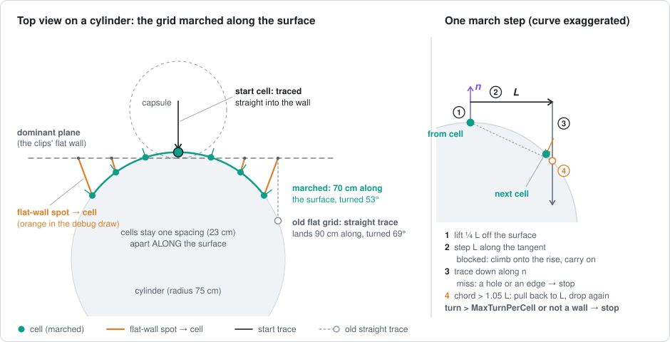
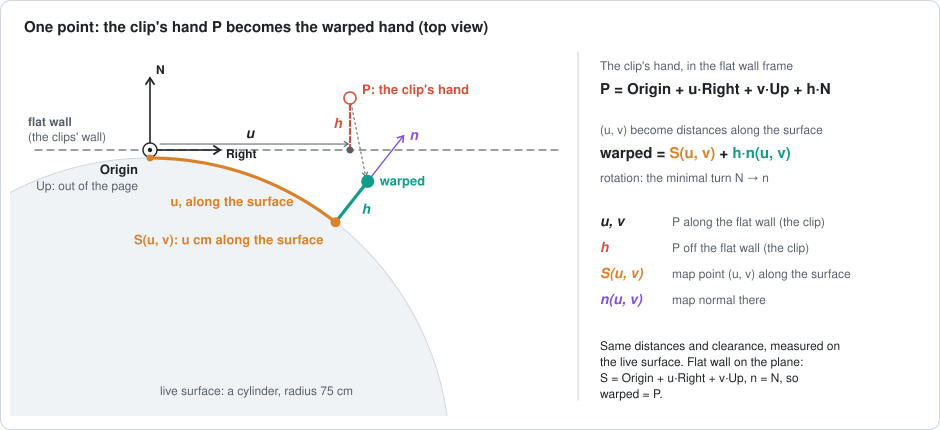
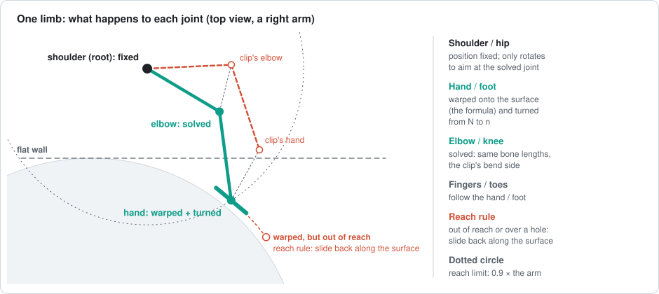

# Climbing — Surface map & warp

The climb clips are authored on a **flat wall**, so on a curved wall the pose floats (convex) or sinks in (concave). On a 75 cm-radius cylinder the gap grows as ~u²/2R, so a hand 60 cm out floats ~30 cm off the surface. The fix has two halves. Every climbing tick the component **marches a small grid over the real surface** (the surface map). A Control Rig pose layer, **Climb Surface Warp**, then moves each limb of the clip's flat pose onto that grid, before the stance IK:

```
warped = S(u, v) + h·n(u, v)
```

The clip's flat `(u, v)` become **distances along the surface**. Its clearance `h` is kept, measured along the local normal `n`. Part of the [Climbing docs](README.md).

## Pipeline
```
component (pre-sim):  dominant plane → march the surface map → pins through the map, leash on the map
rig (anim):           input pose → weight shift → Climb Surface Warp → Climb Limb IK (stance curve)
```
- The stance curve stays a pure IK weight, and the [Climb Limb IK](limb-ik.md) node is unchanged.
- The stance IK only reaches the surface ~0.2 s before contact, which is why the swing itself has to be warped.

## The surface map



### What it records
- **Flat frame** (world space): this is how the clip's pose is read.
  - `Origin` = the capsule centre projected onto the dominant plane.
  - `Up` = gravity flattened onto the plane; `Right` = the climber's right (`Normal × Up`); `Normal` = out of the wall.
- **Grid:** `Columns × Rows` cells over `[Min, Max]` in **surface coordinates `(s, t)`**, in cm **along the surface**. Row 0 is the lowest.
- **Per cell:** `bValid`, plus the world `Point` and `Normal` of the surface.
- **Empty cells:** a hole, past an edge or a corner, or not a wall (a floor, a ledge top).

### Map vs the 3×5 coverage grid
Both sample the wall in front of the climber, and the grid's area sits inside the map's. They have different jobs.

| | 3×5 coverage grid ([Enter detection](climb-enter-detection.md)) | Surface map |
|---|---|---|
| Job | **Decides**: can I climb, can I move, should I fall off | **Describes**: where exactly the surface is, for the pose |
| Feeds | The sim: entry / exit, `CanMoveWhileClimbing`, the dominant plane (climb mode, standoff, capsule tilt, mantle and corner probes) | Presentation only: the warp, pin placement, the leash |
| When | Every tick, including **before** climbing; skipped if the sweep sees nothing | Only while climbing |
| Traces | 15, along the capsule's forward | ~2 per cell (~130): one start trace, the rest marched |
| Area | ±30 cm × about −20…+80 cm | ±70 cm × −110…+90 cm (along the surface) |
| Shape | Coarse on purpose: one smoothed plane; rejects normals > 35° off it | Detailed on purpose: wraps round curves, bridges small holes |
| Dependency | Produces the dominant plane | Built **from** that plane (its frame and its start trace) |

- **Kept separate on purpose:**
  - The map can't run before climbing, because it needs the grid's plane.
  - Gating on the map would let visual tuning (hole bridging, edge extension) change when you fall off.
  - The grid's job is to collapse a curve into one stable plane; the map's job is not to.
- **Possible merge, not planned:** while climbing, the gates and the plane could come from the map cells inside the grid's footprint, leaving the grid for entry only. That saves 15 traces a tick, but adds a frame loop and needs the gates retuned in surface distances.

### How it's marched (`FClimbSurfaceMap::Build`)
- **Start cell:** the cell nearest the body is traced straight into the wall along `−Normal`.
  - The trace runs from `FrontReach` in front of the plane to `BackReach` behind it.
  - A hit counts only if it's a wall that faces the climber (normal · plane normal > 0.3).
  - On a miss, up to 8 nearby cells are tried, preferring ones **above** the body (a dead hang under a lip).
  - The start cell keeps its plane `(u, v)` as its `(s, t)`.
- **Order:** the start row is marched left and right, then every column up and down from it. Then a sideways fill pass covers columns whose start-row cell was a hole.
- **Axes on the surface:** at each cell, `Right` and `Up` are turned by the minimal rotation from the plane normal to the cell's normal (`TangentsAt`). Around a vertical cylinder, `Right` wraps around it and `Up` stays up.
- **One step** (length `L` = one cell spacing):
  1. Lift `¼ L` off the surface.
  2. Step `L` along the tangent. If the surface rises into the step (a concave curve or a hold), climb onto it and carry on with what's left.
  3. Trace down along the normal. A miss means a hole or a sharp edge.
  4. On a convex curve the landing is farther than `L` (the drop adds to the chord). If the chord is over `1.05 L`, pull it back to `L` and drop again.
- **Where a march stops:**
  - two empty cells in a row (it steps over one);
  - a non-wall hit;
  - a turn sharper than `ClimbSurfaceMapMaxTurnPerCell` (inner corners, tight bends).
  - A sharp outer edge is never crossed: its far side runs parallel to the down trace.
- **Turn per cell** ≈ spacing / R: about 18° for a 23 cm spacing on a 75 cm radius.
- **Cost:** ~2 line traces per cell per climbing tick. Line traces, not spheres: a sphere's first contact on a curve is off its centre line.
- **World space, not mesh space:** the movement update moves the body after the map is built, so consumers convert with the transform they actually render with.
- Built only while climbing. Mantling or turning a corner keeps the last map while the warp fades, then drops it.

### Querying it
- `GetClimbSurfaceMap()` on the component; `ClimbSurfaceMap` is also `BlueprintReadOnly` for the AnimBP.
- `Sample(s, t)` returns a point, a normal and a coverage value:
  - bilinear over the four surrounding cells;
  - a missing corner is extended from the valid ones along their tangents, so a point next to a hole stays at its `(s, t)`;
  - past the grid it carries on flat along the edge's tangent;
  - `coverage` = the valid share of the weight (fade a correction by it);
  - false only with no valid corner.
- `Locate(world)` returns the `(s, t)` of the surface point nearest a world point: the nearest cell, then refined on the tangent plane. Use it for points **on** the surface (pins). `ToUV` is only for the clip's flat pose.
- **Reach searches.** A spot = the surface at `(s, t)` plus a height along its normal. It qualifies when it has surface and is within reach of a root.
  - `FindNearestInReach`: any direction (a ring of 16, then refined). Used by the warp's reach rule and the leash fallback.
  - `FindAlongLineInReach`: only along one line, either way. Used by the leash's drag along the clip's line.
- Code: `RogueClimbSurfaceMap.h/.cpp`, a plain struct with no component dependency.

## The warp



| Term | Meaning | Comes from |
|---|---|---|
| `P` | The clip's hand / foot this frame: `Origin + u·Right + v·Up + h·N` | The incoming pose |
| `u`, `v` | `P` along the flat wall from `Origin`: `(P − Origin)·Right`, `·Up` | The clip |
| `h` | `P`'s clearance off the flat wall: `(P − Origin)·N` | The clip |
| `S(u, v)` | The surface point `u` cm right and `v` cm up **along the surface** | Surface map, blended from 4 cells |
| `n(u, v)` | The surface normal there | Surface map, blended from 4 cells |

- **Result:** the clip's distances and clearance, measured on the live surface.
  - A hand 60 cm right of the body lands 60 cm around a cylinder, not 60 cm across and then dropped onto it.
  - Flat wall on the plane: `S = Origin + u·Right + v·Up` and `n = N`, so `warped = P`.
- **Rotation:** the hand / foot also turns by the minimal rotation from `N` to `n`, on top of the clip's rotation.
- **During the swing:** `u, v, h` come from the clip every frame, so the lift, arc and set-down keep the clip's timing and height, measured from the curve.

## The limb



| Joint | What happens |
|---|---|
| Shoulder / hip (`ItemA`) | Position fixed; only rotates to aim at the solved joint |
| Hand / foot (`EffectorItem`) | Warped by the formula, and turned from `N` to `n` |
| Elbow / knee (`ItemB`) | Solved: analytic two-bone, the skeleton's bone lengths, the clip's bend side (learned hinge, swivel 0), never tighter than `MinMidAngle` |
| Fingers / toes | Follow the hand / foot rigidly |
| Pelvis, spine, head | Untouched (the weight shift still applies) |

- **Bone lengths never change.**
- The elbow / knee isn't warped too: it sits farther off the wall, so it would move by a different amount and the bones would stretch.

## Reach rule
- **One limit for everything:** the component's leash limit, published per limb on `FClimbLimbPin::Reach`. The leash and the pins use the same number (see [Stopping well](idle-retreat.md), layer 5).
  - It's measured to the **contact point** (palm socket / ball): `Reach.ContactBone` + `Reach.ContactOffset`.
  - If the clip's own distance is farther, it's kept. Only distance the warp adds is undone, so a flat wall is never pulled in.
- A warped contact past the limit, or over a hole, moves to the **nearest** spot on the map that has surface and is in reach, keeping its clearance.
  - The nearest spot, not "straight toward the shoulder": that would also pull a hold above the shoulder **down** when the extra distance came from a sideways curve.
- If nothing qualifies, the plain warp is used and the limb straightens toward it.

## Pins and leash through the map
- **Pins:** each baked hold is warped the same way (`ResolvePlantTarget`), then confirmed by a trace along the **local** normal.
  - Reach limit = max(the leash ratio × the limb's reach, the clip's own hold distance).
  - Covers the climb, the idle-retreat grips and clip-switch re-grips, so the warped swing and its pin land close together.
- **Leash:** a held pin is found on the map with `Locate`, then dragged along it (see [Stopping well](idle-retreat.md), layer 5).
  - The clip's line has the same `(s, t)` direction everywhere on the map, so a sideways line stays sideways around a cylinder.

## Rig wiring
- One **Climb Surface Warp** per limb, with the same `ItemA` / `ItemB` / `EffectorItem` and axes as that limb's Climb Limb IK.
- `SurfaceMap` ← the component's `ClimbSurfaceMap` (world space; the node converts it with this frame's transform).
- `Weight` ← `ClimbSurfaceWarpWeight`.
- `Reach` ← that limb's pin's `Reach` (e.g. `LeftHandPin.Reach`).
- The Climb Limb IK reads the warped pose as its incoming pose: stance 0 = the warped pose, stance 1 = the pin.

## Settings
| Setting | Where | Default | Meaning |
|---|---|---|---|
| `bBuildClimbSurfaceMap` | Component | on | Off = no traces, empty map |
| `ClimbSurfaceMapColumns` × `Rows` | Component | 7 × 9 | Cells |
| `ClimbSurfaceMapHalfWidth` | Component | 70 cm | Along the surface, to each side of the body |
| `ClimbSurfaceMapBottom` / `Top` | Component | −110 / +90 cm | Along the surface, the wall's up |
| `ClimbSurfaceMapFrontReach` / `BackReach` | Component | 40 / 80 cm | Start trace, in front of / behind the plane |
| `ClimbSurfaceMapMaxTurnPerCell` | Component | 50° | Sharper = an edge or corner: the march stops |
| `bPlacePinsThroughSurfaceMap` | Component | on | Warp the pins |
| `bClimbSurfaceWarp` | Component | on | Off = `ClimbSurfaceWarpWeight` 0 |
| `ClimbSurfaceWarpBlendSpeed` | Component | 8 /s | Weight ease in / out |
| `MinMidAngle` | Node | 30° | Tightest elbow / knee fold |
| `HingeAxis`, `bLearnHingeAxis` | Node | learn | As in Climb Limb IK |

## Debug
- `game.climbing.DebugSurfaceMap` (on by default):
  - **teal** = cells, short normals, the marched wireframe;
  - **orange** / **blue** = a cell's flat-wall spot → the cell, when the cell sits behind / in front of the flat wall (around a curve it also slides sideways);
  - **red** dot = an empty cell, drawn at its flat-wall spot;
  - **grey** = the grid laid flat on the plane, plus a readout of the gap range;
  - **purple** = a pin's flat-wall hold → its warped spot.
- Node `DebugSettings`: **cyan** = flat → warped hand / foot; **orange** = the reach rule kicked in. In PIE this needs `ControlRig.EnableDrawInterfaceInGame 1`.
- Node outputs: `Shift` (cm moved) and `bReachLimited`.

## Limits & next
- Holds and lips smaller than a cell are invisible to the swing (the pin's trace still finds them).
- On a doubly curved surface (a sphere) the grid can't keep every spacing exact; rows and columns are exact, diagonals drift.
- A new start cell (the body's cell becoming a hole) can shift `(s, t)` slightly on a curve.
- Corners stay with the corner-turn system.
- While the weight fades in / out, the clearance is a blend.
- Keep `LimbReachSoftStart` ≥ `LimbReachLeashRatio`, or the reach cap bends held limbs toward the shoulder.
- Holds land closer to the body on convex walls, so the body can outpace a planted limb. The leash and re-grip handle it; a curvature-aware stride is the next lever.
- **Optional:** give the [limb solver](limb-ik.md#next)'s wall check the real surface instead of the flat dominant plane.
  - Only worth it if knees / elbows clip into concave or bumpy walls, or splay near a cylinder's sides.
  - The bend itself stays the clip's.
  - Cheapest form: each limb gets the map's tangent plane near its knee / elbow.
